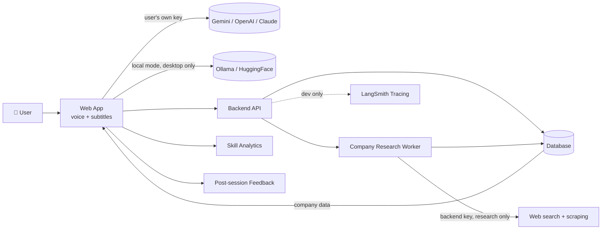

<div align="center">

```
 █████╗ ██████╗ ██╗  ██╗██╗   ██╗ █████╗ ███████╗
██╔══██╗██╔══██╗██║  ██║╚██╗ ██╔╝██╔══██╗██╔════╝
███████║██████╔╝███████║ ╚████╔╝ ███████║███████╗
██╔══██║██╔══██╗██╔══██║  ╚██╔╝  ██╔══██║╚════██║
██║  ██║██████╔╝██║  ██║   ██║   ██║  ██║███████║
╚═╝  ╚═╝╚═════╝ ╚═╝  ╚═╝   ╚═╝   ╚═╝  ╚═╝╚══════╝
```

### 🎤 Practice interviews out loud. Fail here, not there.

**Abhyas** (अभ्यास, *"practice"*) is a free, open-source, voice-first mock interview agent.
It interviews you from your resume, a job description, or your target field, and shows you exactly where you are strong and where you are weak.

<br/>


[**Demo**](#-demo) · [**Features**](#-features) · [**Quick Start**](#-quick-start) · [**Architecture**](#-architecture) · [**Roadmap**](#-roadmap) · [**Contributing**](#-contributing)

</div>

---

## 📖 Table of Contents

- [Why Abhyas](#-why-abhyas)
- [Demo](#-demo)
- [Features](#-features)
- [How It Works](#-how-it-works)
- [Supported AI Models](#-supported-ai-models)
- [Quick Start](#-quick-start)
- [Configuration](#-configuration)
- [Architecture](#-architecture)
- [Project Docs](#-project-docs)
- [Pages](#-pages)
- [Privacy and Security](#-privacy-and-security)
- [Monitoring and Feedback](#-monitoring-and-feedback)
- [Design System](#-design-system)
- [Roadmap](#-roadmap)
- [Contributing](#-contributing)
- [License](#-license)

---

## 💡 Why Abhyas

Interview prep today is either expensive, generic, or both. Reading question lists does not train you to *speak* under pressure.

Abhyas fixes that:

- 🗣️ **Talk, don't type.** Voice conversation with live subtitles, like a real interview.
- 🎯 **Tailored.** Questions come from *your* resume, *your* JD, *your* target company.
- 📊 **Measurable.** Skill-wise scores show your strongest and weakest areas over time.
- 💸 **Free forever.** No subscription. You bring your own AI key, or run a model locally.
- 🔒 **Private.** Open source, and your data stays yours.

---

## 🎬 Demo

> 📸 *Add a GIF or screenshots here once the first build is running.*

| Interview Room | Skill Report | Model Picker |
| :---: | :---: | :---: |
| `docs/screens/interview.png` | `docs/screens/report.png` | `docs/screens/models.png` |

---

## ✨ Features

### 🎙️ Interview Experience
- Voice conversation with real-time **subtitles**
- Interviews generated from **resume**, **job description**, or **field / role**
- Difficulty calibrated to the **experience level** you select
- **Skill-wise practice mode** to drill one area at a time

### 🏢 Company-Aware Prep
- Web search and scraping for company-specific interview info (where data is available)
- Results are **cached per company**, so the next user wanting the same company reuses them
- Sessions are tailored from company data + your resume + the JD
- Research runs on a **pre-seeded company list**, expanded by a **demand threshold** (not on-demand for every company)

### 📈 Progress and Habit
- **Skill analytics:** strongest, weakest, and a skill-by-skill breakdown
- **Daily streaks** and sign-in habit features
- **Google Calendar** connection to schedule practice sessions
- **Post-session feedback:** rate the agent and leave a review after every session

### 🧠 Bring Your Own Model
- Pick any supported provider, plug in your own key
- No key? Download and run a **local model** instead
- Choose from **recommended models** matched to your hardware, or download **any custom model** you like

---

## 🔄 How It Works

```
 ┌──────────────┐     ┌──────────────┐     ┌──────────────┐     ┌──────────────┐
 │  1. SETUP    │ ──► │  2. TAILOR   │ ──► │ 3. INTERVIEW │ ──► │  4. REVIEW   │
 │              │     │              │     │              │     │              │
 │ pick model   │     │ resume + JD  │     │ voice + live │     │ skill scores │
 │ add API key  │     │ + company    │     │ subtitles    │     │ weak/strong  │
 │ or go local  │     │ data + level │     │ follow-ups   │     │ feedback     │
 └──────────────┘     └──────────────┘     └──────────────┘     └──────────────┘
```

---

## 🤖 Supported AI Models

| Provider | Type | Voice | Notes |
| --- | --- | :---: | --- |
| **Google Gemini** | Cloud (BYOK) | ✅ | Bring your own key |
| **OpenAI** | Cloud (BYOK) | ✅ | Bring your own key |
| **Anthropic Claude** | Cloud (BYOK) | ✅ | Bring your own key |
| **Ollama** | Local | ❌ text-only | Desktop only |
| **Hugging Face** | Local | ❌ text-only | Desktop only, any model you download |

> ⚠️ **Local mode rules**
> - Disabled on **mobile phones**.
> - On PC it is **text-only** (no voice) so the local model gets the maximum available resources.
>
> ℹ️ Abhyas does **not** ship a shared AI key. Your key, your usage, your limits.

---

## 🚀 Quick Start

### Prerequisites

<!-- TODO: confirm exact versions once the stack is locked in architecture.md -->

- Node.js `>= 20` and / or Python `>= 3.11` *(per final stack)*
- An API key from **one** supported cloud provider, **or** [Ollama](https://ollama.com) installed for local mode
- A modern browser with microphone access

### Install

```bash
# 1. Clone
git clone https://github.com/<your-username>/abhyas.git
cd abhyas

# 2. Install dependencies
# TODO: replace with the real commands once the stack is finalised
npm install

# 3. Configure environment
cp .env.example .env

# 4. Run
npm run dev
```

Open `http://localhost:3000`, pick a model, paste your key, and start your first interview.

### Running with a local model

```bash
# Install Ollama, then pull a model
ollama pull <model-name>

# In Abhyas: Settings -> Model -> Local -> select your model
```

---

## ⚙️ Configuration

| Variable | Required | Purpose |
| --- | :---: | --- |
| `DATABASE_URL` | ✅ | Stores company research cache, sessions, analytics |
| `RESEARCH_API_KEY` | ✅ | Backend-only key for company scraping and research. **Never used for interviews.** |
| `GOOGLE_CLIENT_ID` | ⬜ | Google Calendar integration |
| `GOOGLE_CLIENT_SECRET` | ⬜ | Google Calendar integration |
| `LANGSMITH_API_KEY` | ⬜ | Dev-phase tracing and evaluation |
| `LANGSMITH_TRACING` | ⬜ | Toggle tracing in development |

> 🔑 **User API keys are not environment variables.** They are entered in the app and never sent to Abhyas servers for storage. <!-- TODO: confirm exact storage approach in architecture.md -->

---

## 🏗️ Architecture



### Key design decisions

| Decision | Why |
| --- | --- |
| **BYOK, no shared key** | Keeps the app free without risking rate limits or cost on a single account |
| **Backend key for research only** | Company data is reusable across users; interviews always run on the user's own model |
| **Cached, demand-gated company research** | Avoids scraping every company on request; seeded list + threshold keeps cost bounded |
| **Text-only local mode** | Frees CPU/GPU/RAM for the local model |
| **MIT license** | Maximum openness and adoption |

---

## 📚 Project Docs

Four governing spec files drive the build. If they ever conflict, higher in this list wins.

| Priority | File | Purpose |
| :---: | --- | --- |
| 1 | [`PRD.md`](./PRD.md) | What we are building and why |
| 2 | [`architecture.md`](./architecture.md) | System design, data flow, tech stack |
| 3 | [`design.md`](./design.md) | Visual language, components, tokens |
| 4 | [`phases.md`](./phases.md) | Build order, milestones, page creation schedule |
| 5 | Existing code | Lowest precedence |

These docs are written to be detailed enough for an AI coding agent to build and maintain the project.

---

## 🗺️ Pages

<!-- TODO: sync this table with the full page list and creation phases in phases.md -->

| Page | Purpose | Phase |
| --- | --- | :---: |
| Landing | Pitch, demo, call to action | TBD |
| Onboarding / Model Setup | Pick provider, enter key, or download local model | TBD |
| Profile and Resume | Upload resume, set experience level | TBD |
| Session Setup | Choose JD, company, field, or skill focus | TBD |
| Interview Room | Voice + subtitles live session | TBD |
| Session Report | Scores, strengths, weaknesses | TBD |
| Dashboard | Streaks, trends, skill breakdown | TBD |
| Skill Practice | Drill one skill at a time | TBD |
| Calendar | Google Calendar scheduling | TBD |
| Feedback | Rate the agent after a session | TBD |
| Settings | Model, keys, privacy, data export | TBD |

---

## 🔒 Privacy and Security

- ✅ Open source: audit every line
- ✅ No shared AI key, so your interviews run on **your** model and **your** key
- ✅ Local mode keeps everything on your machine
- ✅ Backend research key is used **only** to gather public company info
- ⚠️ If you use a cloud provider, your interview content is subject to **that provider's** policy

Found a vulnerability? Please open a private security advisory instead of a public issue.

---

## 📡 Monitoring and Feedback

**During development**
- Tracing with **LangSmith** to inspect each agent run
- Review whether the agent asks sensible questions, evaluates answers correctly, and **avoids hallucination**
- Use traces to decide what to change in prompts and agent logic

**After every session (production)**
- Users **score the agent** and leave a short written review
- Feedback is aggregated to guide improvements

---

## 🎨 Design System

Abhyas uses a **retro-pixel** visual direction.

| Role | Font |
| --- | --- |
| Display / headings | **Pixelify Sans** |
| UI / body | **Instrument Sans** |
| Code / data | **JetBrains Mono** |
| Handwritten accents | **Caveat** |

> 🔤 These four fonts are fixed. Do not swap them. Full tokens and components live in [`design.md`](./design.md).

---

## 🛣️ Roadmap

<!-- TODO: mirror the real milestones from phases.md -->

- [ ] **Phase 1:** Core interview loop (text) with BYOK providers
- [ ] **Phase 2:** Voice input/output and live subtitles
- [ ] **Phase 3:** Resume + JD tailoring, experience-level calibration
- [ ] **Phase 4:** Skill analytics, skill-wise practice, streaks
- [ ] **Phase 5:** Company research pipeline and shared cache
- [ ] **Phase 6:** Local models (Ollama, Hugging Face) with model picker and downloads
- [ ] **Phase 7:** Google Calendar integration
- [ ] **Phase 8:** Post-session feedback, polish, public launch

---

## 🤝 Contributing

Contributions are welcome.

1. Fork the repo
2. Create a branch: `git checkout -b feat/your-feature`
3. Read the [project docs](#-project-docs) first, especially `PRD.md` and `architecture.md`
4. Commit with clear messages
5. Open a pull request describing **what** and **why**

Please keep the fixed fonts and the retro-pixel design language intact.

---

## 📄 License

Released under the **[MIT License](./LICENSE)**. Free to use, modify, and distribute.

---

<div align="center">

**अभ्यास करो. बेहतर बनो.**
*Practice. Improve. Get hired.*

Made with ☕ and a lot of mock interviews.

⭐ **Star the repo if Abhyas helps you land an offer.**

</div>