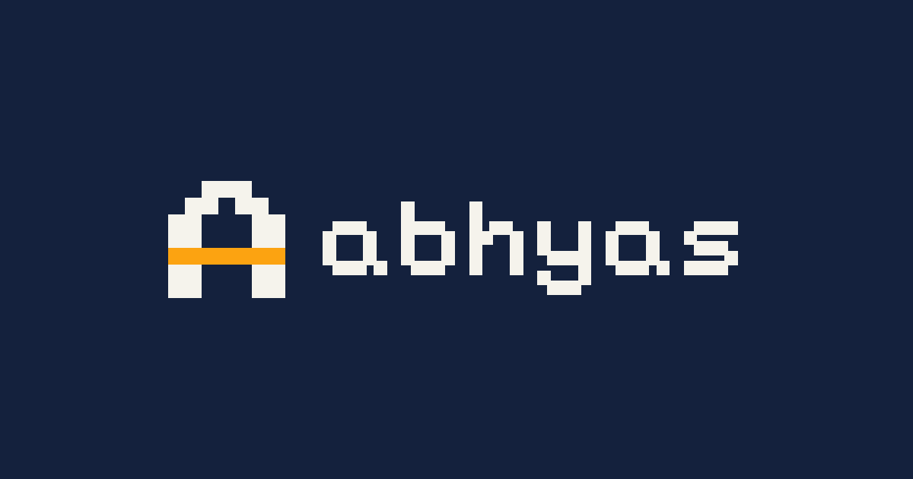
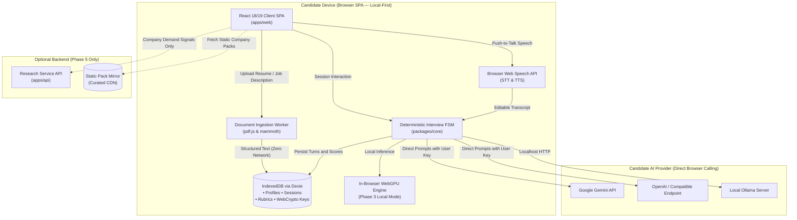

<div align="center">

<picture>
  <source media="(prefers-color-scheme: dark)" srcset="Assets/svg/abhyas-lockup-dark.svg">
  <source media="(prefers-color-scheme: light)" srcset="Assets/svg/abhyas-lockup.svg">
  
</picture>

### 🎤 Practice interviews out loud. Fail here, not there.

**Abhyas** (अभ्यास, *"practice"*) is a free, open-source, voice-first mock interview agent.  
It interviews you from your resume, a job description, or your target field, and shows you exactly where you are strong and where you are weak.

<br/>

[](./LICENSE)
[](./phases.md)
[](#-supported-ai-models)
[](#-running-with-a-local-model)
[](#-contributing)

[**Demo**](#-demo) · [**Features**](#-features) · [**How It Works**](#-how-it-works) · [**Supported Models**](#-supported-ai-models) · [**Quick Start**](#-quick-start) · [**Architecture**](#-architecture) · [**Roadmap**](#-roadmap) · [**Contributing**](#-contributing)

</div>

---

## 📖 Table of Contents

- [💡 Why Abhyas](#-why-abhyas)
- [🎬 Demo](#-demo)
- [✨ Features](#-features)
- [🔄 How It Works](#-how-it-works)
- [🤖 Supported AI Models](#-supported-ai-models)
- [🚀 Quick Start](#-quick-start)
- [⚙️ Configuration](#-configuration)
- [🏗️ Architecture](#-architecture)
- [📚 Project Docs](#-project-docs)
- [🗺️ Pages](#-pages)
- [🔒 Privacy and Security](#-privacy-and-security)
- [📡 Monitoring and Quality](#-monitoring-and-quality)
- [🎨 Design System](#-design-system)
- [🛣️ Roadmap](#-roadmap)
- [🤝 Contributing](#-contributing)
- [📄 License](#-license)
- [👤 Author](#-author)

---

## 💡 Why Abhyas

Interview prep today is either expensive, generic, or privacy-invasive. Reading static question lists does not train you to *speak* with structure under pressure, while cloud-hosted mock interview platforms harvest sensitive resumes, record audio to vendor servers, and enforce recurring subscriptions.

Abhyas fixes that:

- 🗣️ **Talk, don't type.** Push-to-talk voice conversation with live subtitles and editable transcripts, like a real interview.
- 🎯 **Tailored to you.** Questions are synthesized from *your* resume, *your* job description, and *your* target company while preserving core evaluation intent.
- 📊 **Measurable & grounded.** Multi-dimensional STAR rubric scoring with honest sample-size confidence intervals. Rewrites reference only verifiable profile facts — zero hallucinated experience.
- 💸 **Free forever.** No subscription or credits. Bring your own AI key (BYOK), or run a model completely offline.
- 🔒 **Private & local-first.** Your resume, job descriptions, answers, transcripts, and evaluation scorecards live strictly in your browser (`IndexedDB` via Dexie). Nothing is uploaded to central project servers.

---

## 🎬 Demo

<div align="center">

<picture>
  <source media="(prefers-color-scheme: dark)" srcset="Assets/svg/abhyas-lockup-dark.svg">
  <source media="(prefers-color-scheme: light)" srcset="Assets/svg/abhyas-lockup.svg">
  
</picture>

<p><em>Visual preview of the Abhyas retro-pixel interview suite:</em></p>



</div>

| Live Interview Room | Results Scorecard | AI Model Picker |
| :---: | :---: | :---: |
| `PG-12`: Voice push-to-talk, live subtitles & editable transcript *(Phase 1)* | `PG-13`: STAR rubric breakdown & grounded rewrites *(Phase 1)* | `PG-09`: Gemini, OpenAI & local model configuration *(Phase 1)* |

> 📸 *Live interface capture walkthroughs will be recorded upon Phase 1 release.*

---

## ✨ Features

### 🎙️ Voice-First Interview Experience
- **Push-to-talk voice conversation:** Speak your answers naturally using browser speech recognition.
- **Editable interim transcript:** Review and correct speech transcription errors before submitting for evaluation.
- **Real-time spoken feedback:** Browser speech synthesis speaks questions with synchronized live subtitles.
- **Interactive controls:** Pause, repeat question, request hint, skip, or wrap up early at any time.

### 🎯 Tailored Preparation
- **Local document parsing:** Ingest resumes (PDF, DOCX, text) and job descriptions entirely client-side inside a Web Worker.
- **Role & level calibration:** Calibrated across 5 experience levels (Intern/Fresher, Junior, Mid, Senior, Staff+) to adjust question depth and rubric expectations.
- **Vetted question engine:** Questions are drawn from curated, tagged banks and personalized to your projects while strictly preserving core evaluation criteria.

### 🏢 Company-Aware Prep
- **Curated company packs (Phase 4):** Practice with vetted, evidence-backed company question packs and cultural cues.
- **Demand-gated research service (Phase 5):** Bounded, budget-capped backend scraping service (FastAPI + LangGraph) generates company packs based on community demand signals.

### 📈 Honest Analytics & Habit
- **Skill analytics (Phase 2):** Competency tracking across technical and behavioral taxonomy with honest confidence bars based on sample size.
- **Calibrated drills (Phase 2):** Micro-sessions targeting a single weak skill with focused difficulty.
- **Practice habits (Phase 2):** Local-only streak tracking and session history.
- **Calendar study plans (Phase 6):** Export interview preparation schedules as standard `.ics` files, with optional Google Calendar sync.

### 🧠 Bring Your Own Model (BYOK & Local)
- **Direct provider connection:** Connect your own Google Gemini or OpenAI key directly from the browser — zero project proxies.
- **Encrypted key storage:** Keys are stored in IndexedDB with optional WebCrypto AES-GCM passphrase encryption.
- **Offline local mode:** Run text interviews completely offline on desktop PCs using in-browser WebGPU (WebLLM) or a local Ollama server.

---

## 🔄 How It Works

```
 ┌──────────────┐     ┌──────────────┐     ┌──────────────┐     ┌──────────────┐
 │  1. SETUP    │ ──► │  2. TAILOR   │ ──► │ 3. INTERVIEW │ ──► │  4. REVIEW   │
 │              │     │              │     │              │     │              │
 │ pick model   │     │ resume + JD  │     │ voice + live │     │ STAR rubrics │
 │ add API key  │     │ parsed in    │     │ subtitles    │     │ top 3 fixes  │
 │ or go local  │     │ Web Worker   │     │ follow-ups   │     │ rewrites     │
 └──────────────┘     └──────────────┘     └──────────────┘     └──────────────┘
```

1. **Connect Provider:** Connect an API key (Gemini, OpenAI, or compatible endpoint) or switch to local offline mode.
2. **Ingest Documents:** Upload your resume (PDF/DOCX) and paste the job description. The Web Worker extracts text locally and caches a condensed `StructuredProfile` (target <= 1,200 tokens).
3. **Question Selection:** The engine selects vetted questions from `packages/content` matching your role and level, personalizing wording to your projects.
4. **Live Interview Session:** The interviewer speaks the question. Answer out loud using push-to-talk, edit the live transcript if needed, and submit.
5. **Rubric Evaluation:** Answers are scored at temperature 0 against 5-level rubric anchors (Content, STAR Structure, Technical Depth, Delivery).
6. **Actionable Scorecard:** Receive a detailed scorecard highlighting top actionable fixes and grounded candidate answer rewrites.

---

## 🤖 Supported AI Models

| Provider | Type | Mode | Notes |
| --- | --- | :---: | --- |
| **Google Gemini** | Cloud (BYOK) | Voice + Text | Direct browser calls, structured JSON mode, temperature 0 |
| **OpenAI** | Cloud (BYOK) | Voice + Text | Direct browser calls, structured schema support |
| **OpenAI-Compatible** | Cloud / Self-hosted (BYOK) | Voice + Text | Configurable base URL (e.g. OpenRouter, vLLM, private endpoints) |
| **WebGPU (WebLLM)** | Local In-Browser | Text-only | Desktop PC only, zero install, runs fully offline via WebGPU |
| **Ollama** | Local REST Server | Text-only | Desktop PC only, connects to `localhost:11434` with CORS |
| **Anthropic Claude** | Cloud (BYOK) | Planned | Scheduled for evaluation in Phase 7 |

> ⚠️ **Local mode rules**
> - Disabled on **mobile phones**.
> - On PC it is **text-only** (no voice) so device resources are dedicated entirely to the local model.
>
> ℹ️ Abhyas does **not** ship a shared AI key for interviewing. Your key, your usage, your limits.

---

## 🚀 Quick Start

### Prerequisites

- **Node.js** `>= 20.12.0`
- **pnpm** `>= 9.0.0`
- **Python** `>= 3.11` *(required only for Phase 5 backend research service)*
- An API key from **Google Gemini** or **OpenAI**, **or** a local engine ([Ollama](https://ollama.com) / WebGPU)
- A modern browser with microphone access (Chrome, Edge, or Firefox)

### Install

```bash
# 1. Clone the repository
git clone https://github.com/Samyak9109/Abhyas.git
cd Abhyas

# 2. Install monorepo dependencies
pnpm install

# 3. Configure environment
cp .env.example .env

# 4. Start development server
pnpm dev
```

Open `http://localhost:5173`, choose an AI model, enter your key, and start your first practice session.

### Monorepo Validation Commands

```bash
# Run unit and contract test suites
pnpm test

# Run strict TypeScript type checks across all workspaces
pnpm typecheck

# Run linter and import boundary checks
pnpm lint

# Run dead-code and unused-dependency checks
pnpm knip

# Build all applications and packages for production
pnpm build
```

### Running with a local model

```bash
# 1. Install Ollama, then pull a supported model
ollama pull llama3.2

# 2. In Abhyas: Settings -> AI Provider -> Local -> select Ollama
```

---

## ⚙️ Configuration

The project template `.env.example` provides settings for local development and the optional Phase 5 backend:

| Variable | Scope | Required | Purpose |
| --- | --- | :---: | --- |
| `VITE_APP_NAME` | Client | ⬜ | Application title (default: `"Abhyas"`) |
| `VITE_API_URL` | Client | ⬜ | Optional Phase 5 research backend URL (default: `http://localhost:8000`) |
| `VITE_STATIC_PACKS_URL` | Client | ⬜ | Optional static CDN mirror URL for company question packs |
| `PORT` | Backend (P5) | ⬜ | Backend service port (default: `8000`) |
| `DATABASE_URL` | Backend (P5) | ✅ (P5) | PostgreSQL connection string for company research cache |
| `PROJECT_AI_PROVIDER` | Backend (P5) | ✅ (P5) | Backend research provider (`"gemini"` or `"openai"`). **Never used for interviews.** |
| `PROJECT_AI_API_KEY` | Backend (P5) | ✅ (P5) | Server-side API key for public company research only |
| `DAILY_BUDGET_CENTS` | Backend (P5) | ✅ (P5) | Hard daily spend cap in cents (default: `500` = $5.00) |
| `MONTHLY_BUDGET_CENTS` | Backend (P5) | ✅ (P5) | Hard monthly spend cap in cents (default: `10000` = $100.00) |
| `TURNSTILE_SECRET_KEY` | Backend (P5) | ⬜ | Cloudflare Turnstile anti-bot secret for public request endpoints |

> 🔑 **Candidate API keys are NEVER environment variables.**  
> User keys are entered securely in the application settings and stored in browser IndexedDB (encrypted with WebCrypto AES-GCM). They are transmitted directly to your chosen provider and never reach project infrastructure.

---

## 🏗️ Architecture



### Key Design Decisions

| Decision | Rationale |
| --- | --- |
| **Local-first & accountless (ADR-001)** | Candidate data stays on the candidate's device. Zero server storage, zero user accounts, zero data liability. |
| **Direct provider calls (ADR-002)** | Eliminates proxy infrastructure costs and security exposure. The project never proxies interview audio or prompts. |
| **Framework-free core (ADR-016)** | Pure TypeScript domain logic (`packages/core`) has zero imports from React or browser DOM, guaranteeing testability. |
| **IndexedDB through Dexie (ADR-004)** | Structured client storage, transactions, indexes, and automated schema migration harness. |
| **Self-hosted typography (ADR-020)** | Prevents visitor IP leakage to font CDNs; guarantees brand integrity. |
| **Demand-gated research (ADR-010)** | Company research runs only for pre-seeded companies or after reaching demand thresholds; guarded by hard daily budgets. |
| **Zero dead code (ADR-022)** | Knip and TypeScript unused-locals checks enforce that no dead code, exports, or dependencies remain. |

---

## 📚 Project Docs

Specification and governance follow a strict authority hierarchy:

$$\text{PRD.md} > \text{architecture.md} > \text{design.md} > \text{phases.md} > \text{existing code}$$

| Priority | Document | Purpose |
| :---: | --- | --- |
| 1 | [`PRD.md`](./PRD.md) | Product Requirements Document: user personas, requirements (FR-001–033, NFR-001–025, AI-001–025) |
| 2 | [`architecture.md`](./architecture.md) | System design, monorepo layout, state machine, provider contracts, security/CSP, and ADR-001–022 |
| 3 | [`design.md`](./design.md) | Visual design specifications, retro-pixel design tokens, component specifications, accessibility |
| 4 | [`phases.md`](./phases.md) | Phased build order (P0–P7), milestones, acceptance criteria, and Definition of Done |
| — | [`docs/privacy-audit.md`](./docs/privacy-audit.md) | Privacy audit, allowed outbound destinations, and Content Security Policy |
| — | [`AGENTS.md`](./AGENTS.md) | Operational guidelines, token economy, non-negotiables, and developer rules |

---

## 🗺️ Pages

| Page ID | Route | Screen Name | Phase & Milestone |
| :---: | --- | --- | :---: |
| `PG-01` | `/` | Landing page | Phase 1 (M1.9) |
| `PG-02` | `/privacy` | Privacy policy & data audit | Phase 1 (M1.9) |
| `PG-03` | `/open-source` | Open source & license information | Phase 1 (M1.9) |
| `PG-04` | `/guide/keys` | Free API key setup guide | Phase 1 (M1.9) |
| `PG-05` | `/troubleshooting` | Troubleshooting & browser compatibility | Phase 1 (M1.9) |
| `PG-08` | `/404` | Not-found & offline shell | Phase 1 (M1.9) |
| `PG-09` | `/setup/ai` | AI provider & key setup | Phase 1 (M1.2) |
| `PG-10` | `/setup/profile` | Resume & job description profile | Phase 1 (M1.3) |
| `PG-11` | `/setup/session` | Session setup & question target | Phase 1 (M1.4) |
| `PG-12` | `/interview` | Live interview room (voice + subtitles) | Phase 1 (M1.5, M1.6) |
| `PG-13` | `/results` | Session results & STAR scorecard | Phase 1 (M1.7) |
| `PG-14` | `/app` | Home dashboard & recent sessions | Phase 1 (M1.1 minimal), Phase 2 (full) |
| `PG-15` | `/app/skills` | Skills breakdown & confidence trends | Phase 2 (M2.1) |
| `PG-16` | `/app/drills` | Single-skill practice drills | Phase 2 (M2.2) |
| `PG-17` | `/app/calendar` | Preparation roadmap & calendar | Phase 6 (M6.1) |
| `PG-18` | `/settings` | Settings, data export & wipe | Phase 1 (M1.1) |

---

## 🔒 Privacy and Security

- ✅ **Local-first data sovereignty:** Resumes, transcripts, answers, and scores reside solely in browser IndexedDB.
- ✅ **No server proxying:** Direct browser-to-provider API calls using your own key.
- ✅ **Passphrase encryption:** Optional WebCrypto AES-GCM encryption for stored API keys.
- ✅ **Zero telemetry:** Zero analytics scripts, tracking cookies, or remote error reporting (ADR-018).
- ✅ **Strict Content Security Policy:** Script and font sources locked to `'self'`. Zero font CDN requests.
- ✅ **Verified network allowlist:** Automated Playwright network tests in CI verify that no unauthorized outbound connections occur.
- ✅ **Prompt injection defense:** Resume and JD inputs are isolated in delimited data wrappers; outputs must pass strict Zod schemas.
- ✅ **Safe data deletion:** Single-click total database wipe completely purges all IndexedDB Dexie tables and local storage.

---

## 📡 Monitoring and Quality

- **Local diagnostics:** In-browser diagnostics panel with redacted event log and storage quota inspector (ADR-018).
- **AI evaluation golden set:** Labeled benchmark of >= 20 transcripts with expert anchor scores; temperature 0 scoring differs by <= 0.5 MAE across runs (AI-025).
- **Zero dead code:** CI runs automated Knip and TypeScript unused-locals checks on every pull request.
- **Accessibility gates:** Automated axe checks verify WCAG 2.2 AA contrast and keyboard accessibility across both themes.

---

## 🎨 Design System

Abhyas uses a **retro-pixel** visual aesthetic: near-black "Ink" ground with warm cream "Paper" cards, vibrant orange accents, hairline borders, square corners, and a pixel monitor-head interviewer mascot.

| Role | Typeface | Format | Source |
| --- | --- | --- | --- |
| **Display / Headings** | **Pixelify Sans** | Latin-subset woff2 | Self-hosted (`apps/web/src/fonts/`) |
| **UI / Body Text** | **Instrument Sans** | Latin-subset woff2 | Self-hosted (`apps/web/src/fonts/`) |
| **Code / Labels / Metrics** | **JetBrains Mono** | Latin-subset woff2 | Self-hosted (`apps/web/src/fonts/`) |
| **Handwritten Accents** | **Caveat** | Latin-subset woff2 | Self-hosted (`apps/web/src/fonts/`) |

> 🔤 *These four fonts are locked (ADR-020). No font CDNs are queried. Full design tokens live in [`design.md`](./design.md).*


---

## 🤝 Contributing

Contributions are welcome. Please read [AGENTS.md](./AGENTS.md) and [architecture.md](./architecture.md) before submitting code.

1. Fork the repo
2. Create a branch: `git checkout -b feat/your-feature`
3. Trace your changes to requirement IDs (e.g. `// FR-012`, `// ADR-007`)
4. Ensure `pnpm test`, `pnpm typecheck`, `pnpm lint`, and `pnpm knip` pass cleanly
5. Commit with clear conventional messages
6. Open a pull request describing **what** changed and **why**

Please keep the locked typefaces, token-based styling, and local-first invariants intact.

---

## 📄 License

- **Code:** Released under the **[MIT License](./LICENSE)**. Copyright © 2026 Samyak Jain.
- **Brand & Mascot:** The name "Abhyas" and the pixel monitor-head visual assets are protected trademarks governed by **[TRADEMARK.md](./TRADEMARK.md)**.

---

## 👤 Author

<table border="0">
  <tr>
    <td width="80" align="center" valign="middle">
      
    </td>
    <td valign="middle">
      <strong>Samyak Jain</strong><br/>
      <em>Creator & Maintainer of Abhyas</em><br/>
      <a href="https://github.com/Samyak9109"></a>
      <a href="https://www.linkedin.com/in/samyak-jain-122aaa273/"></a>
    </td>
  </tr>
</table>

---

<div align="center">

**अभ्यास करो. बेहतर बनो.**  
*Practice. Improve. Get hired.*

Made with ☕ and a lot of mock interviews.

⭐ **Star the repo if Abhyas helps you land an offer.**

</div>
